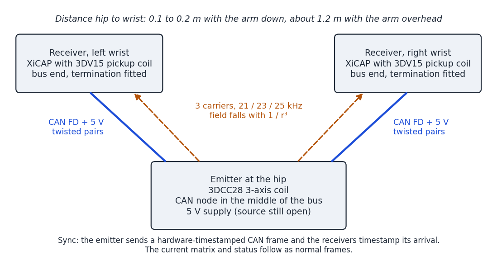
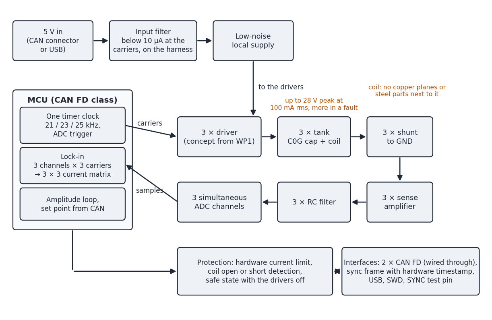
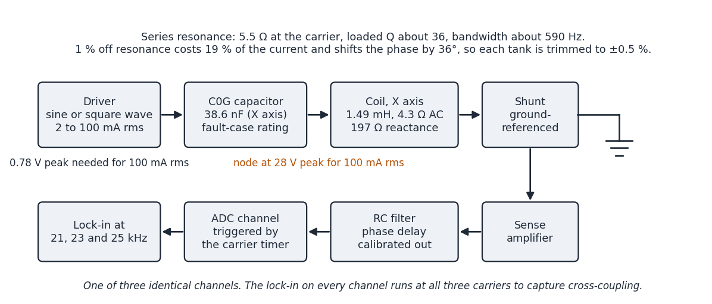

# XiCAP EM Emitter

An open-hardware 3-axis electromagnetic field source for the XiCAP body-worn tracker.

**Status: planning.** There is no hardware or source code yet. This repository holds the
engineering plan, the numbers behind it and the design targets for a first board (rev A).
It exists so that the work can be done in the open and so that anyone who wants to build,
review or improve a low-frequency EM tracking emitter can start from a documented baseline.

This is a community project, not a product. It complements the XiCAP tracker, which is
developed separately; nothing here is for sale and there is no commercial support.

## Why an emitter

XiCAP is a small body-worn tracker. Besides its optical and inertial sensors it carries a
3-axis electromagnetic receiver: a 3-axis pickup coil, three instrumentation amplifiers and a
simultaneous-sampling ADC. Electromagnetic tracking needs a known field to measure against,
and that field has to come from somewhere.

The emitter is that source: a board that drives a 3-axis transmit coil with three continuous
sine currents, one frequency per axis. A receiver measures the 3 × 3 coupling matrix between
its own three axes and the three emitter axes, and from that matrix computes its position and
orientation relative to the emitter. The method is decades old; the point of this project is
a small, wearable, well-characterised implementation whose design reasoning is written down.

The first use case is motion capture on the body: the emitter is worn at the hip, receivers
are worn at the wrists, and everything is connected by a CAN bus that also carries the time
reference. That geometry drives most of the design choices below.



## What the emitter has to do

| Requirement | Why |
|---|---|
| Three continuous carriers, 21 / 23 / 25 kHz, from one clock | One frequency per axis lets the receiver separate the axes by frequency. The ratio 21 : 23 : 25 gives a 1 ms common frame in which every carrier has a whole number of cycles |
| Coil current 2 to 100 mA rms per axis, settable at run time | With a wrist 0.1 to 0.2 m from the hip, the receiver's fixed-gain front end clips above a few tens of mA. With the arm stretched out, more current helps. The current must move with the situation |
| Measure its own current, as a 3 × 3 complex matrix | The field is proportional to the current, and the three windings share one core, so some of each axis's current appears in the other two. The receiver needs the real matrix, not the set point |
| Hardware-timestamped sync over CAN | The receiver's clock is free-running. Without a time reference it cannot tell the sign of the field. Better than 10 µs is needed, 1 µs is the target |
| Clean supply current on the harness | The cable to the wrist passes the receiver coil. 1 mA of carrier-frequency current in an untwisted wire, 2 cm away, equals the emitter's own field at 1 m |
| Safe on the body | Hardware current limit, fault analysis for the resonant tank, and an exposure assessment against the ICNIRP reference levels |

## The receiver it feeds

These facts about the XiCAP receive chain constrain the emitter and are fixed for this project.

| Item | Value |
|---|---|
| Pickup coil | Premo 3DV15-A-S0900J, 9.0 / 9.0 / 10.6 mH, Q about 6 at 20 kHz |
| Coil sensitivity | at least 19 mV per A/m at 20 kHz |
| Tuning | none; the coil feeds the amplifier directly, so the receiver is broadband |
| Amplifier | fixed gain 98 |
| Anti-alias filter | single RC, corner 103 kHz |
| ADC | 16-bit, 4 channels sampled simultaneously, 2.5 V span |
| Sample rate | 100 to 187.5 kSPS per channel (not frozen) |
| Full scale at the coil | ±12.5 mV peak for the sum of all three carriers |
| Noise at the coil | about 33 nV rms in a 100 Hz bandwidth |
| Clock | its own crystal, not locked to the emitter |
| Wired interface | CAN FD on a JST-SH 4-pin: 1 CAN_H, 2 CAN_L, 3 5 V, 4 GND |

Three consequences: everything the emitter radiates below about 100 kHz reaches the receiver's
ADC and everything above its Nyquist frequency aliases, so harmonics count; the receiver needs a
time reference from the emitter; and because the receiver gain is fixed, the usable signal range
is set by the emitter current alone.

## Proposed architecture (rev A)



One timer clock generates the three carriers, the ADC trigger and the CAN timestamp. Each axis
is a series-resonant tank (C0G capacitor plus one coil winding) driven by a per-axis driver and
returned to ground through a shunt. Three simultaneous ADC channels sample the shunt voltages;
the firmware runs a lock-in at all three carrier frequencies on all three channels, closes a slow
amplitude loop and reports the current matrix over CAN.



Design rules for the board:

- No copper planes under or next to the coil, and no steel parts near it (connector shells,
  shielded inductors, screws, battery). Eddy currents and steel distort the field and lower Q.
- The three carriers keep a fixed, documented phase relation at the start of every frame.
- The sense chain's own phase delay is calibrated out, to a residual of 0.1°.
- Voltage rating and creepage at the coil-capacitor node are sized for the fault case in which
  the driver puts its full supply across a tuned tank.
- A hardware current limit that does not depend on firmware.
- Any switching regulator stays away from 15 to 30 kHz and from the low harmonics of the carriers.

## Key numbers

All figures are calculated from datasheets. Nothing has been measured yet; checking them is the
first work package. The full derivation is in [docs/plan.md](docs/plan.md).

**Coil.** Premo 3DCC28-A-0150J: 1.49 / 1.46 / 1.39 mH (X/Y/Z), Q 46 at 20 kHz, DCR at most
3.2 Ω, 8.9 nT at 1 m for 0.25 A rms, 39.5 × 39.5 × 38.6 mm, through-hole.

**Tank.** Resonating capacitors of about 38.6 / 32.8 / 29.2 nF. Loop resistance about 5.5 Ω,
loaded Q about 36, bandwidth about 590 Hz. A tank 1 % off the carrier loses 19 % of its current
and shifts phase by 36°, so each tank is trimmed to ±0.5 % and the current is closed-loop.

**Drive.** 100 mA rms needs only 0.78 V peak across the tank; 2 mA rms needs 16 mV. A
square-wave bridge is a poor fit for that range. A linear sine driver (DAC, line-driver op-amp,
tank, shunt) is the leading candidate: power is below 0.1 W per axis and a sine removes the
harmonic and aliasing questions.

**Link budget, hip to wrist.** The closest wrist position limits the current, because the
receiver must not clip; the noise at full reach follows from that.

| Closest wrist distance | Highest current without clipping | Range noise at 1.2 m (100 Hz) |
|---|---|---|
| 0.10 m | 5.6 mA rms | about 8 mm |
| 0.15 m | 19 mA rms | about 2 mm |
| 0.20 m | 45 mA rms | about 1 mm |
| 0.25 m | 87 mA rms | about 0.5 mm |

Moving the closest approach from 0.10 m to 0.20 m buys 19 dB at full reach, so where the emitter
sits on the hip matters as much as the electronics.

**Exposure.** A dipole estimate puts one axis at the ICNIRP 2010 general-public reference level
(27 µT, shared by three carriers) about 4 to 5 cm from the coil centre at 19 mA rms and 6 to 7 cm
at 45 mA rms. The estimate is conservative in two ways and crude in one; a proper assessment is
part of the first work package. Exposure and the near-wrist limit point the same way: low current.

## Design targets, rev A

| Parameter | Target |
|---|---|
| Coil | Premo 3DCC28-A-0150J |
| Carriers | 21 / 23 / 25 kHz, continuous, from one clock |
| Coil current | 2 to 100 mA rms per axis, set per axis over CAN |
| Current step | settles within 10 ms, reported current valid throughout |
| Amplitude stability | 0.1 % over 10 minutes at constant temperature |
| Amplitude over temperature | reported value correct within 0.5 % from 10 to 50 °C |
| Reported phase | within 0.1° after calibration |
| Current distortion | harmonics below 1 % of the fundamental |
| Current matrix | 3 × 3 complex values, updated at 100 Hz or faster |
| Sync | CAN sync frame timestamped in hardware, error below 1 µs against the carriers |
| Harness cleanliness | below 10 µA rms at each carrier frequency on the supply wires |
| Supply | 5 V from the CAN connector or USB |
| Interfaces | 2 × CAN FD (wired through), USB, SWD, SYNC test pin |
| Protection | hardware current limit, coil open or short detection, safe state with drivers off |
| Board | 2 or 4 layers; coil plus board in one small wearable box |

## Roadmap

| Step | Content | Done when |
|---|---|---|
| WP0 Kick-off | Settle the open decisions, agree tools | Every open decision has an answer or an owner |
| WP1 Paper design | Driver concept, tank tolerances, coupled-tank simulation, sense-chain error budget, MCU and clock tree, supply filter, exposure and fault analysis | Design note reviewed, targets frozen |
| WP2 Bench prototype | One axis, then three, on evaluation boards with the real coil: L, Q, coupling factor, harmonics, cross-currents, harness current, field at a known distance | Measurements agree with the model, or the model is corrected |
| WP3 Rev A board | KiCad schematic and layout, trim footprints, test points, two reviews | Boards ordered |
| WP4 Bring-up | Firmware for carriers, lock-in, amplitude loop, protection, CAN sync; characterisation against every design target | Every target measured and met or explained |
| WP5 Integration | Emitter at the hip, receiver at the wrist: levels, noise, sync, run-time current changes, interference | Joint test report and a rev B list |

## Open decisions

| # | Decision | Why it matters |
|---|---|---|
| D1 | Does the emitter carry the battery and feed 5 V to the receivers, or is it fed from elsewhere? | Supply design, input filter, connector current |
| D2 | Exact position on the hip and the closest wrist distance to design for | Sets the current range (see the link budget) |
| D3 | Number of receivers on the bus | Connectors and termination; two assumed |
| D4 | Driver concept and MCU | Everything else follows from it |
| D5 | Firmware split between the emitter and the tracker side | The emitter does bring-up firmware; the tracker side owns the CAN protocol |

Settled so far: body-worn at the hip, receivers at the wrist, sync over CAN, no pose solver on
the emitter, first build of three boards and three coils.

## Repository layout

```
docs/plan.md        full engineering plan: numbers, derivations, work packages, risks
docs/img/           diagrams used in this README and the plan
docs/references.md  datasheets and standards referred to
hardware/           KiCad project (empty until WP3)
firmware/           bring-up firmware (empty until WP4)
```

## Contributing

Reviews of the numbers are the most useful contribution right now, especially the exposure
estimate, the cross-coupling argument and the driver choice. Open an issue with the section you
are questioning and your own derivation. See [CONTRIBUTING.md](CONTRIBUTING.md) for conventions.

## License

Hardware design files are released under the CERN Open Hardware Licence Version 2, Weakly
Reciprocal (CERN-OHL-W-2.0), see [LICENSE](LICENSE). Firmware added later will carry its own
license file in `firmware/`. Documentation is CC BY 4.0 unless stated otherwise.

XiCAP is a trademark of its maker; this repository is an independent companion project and
implies no commercial offer or warranty.
