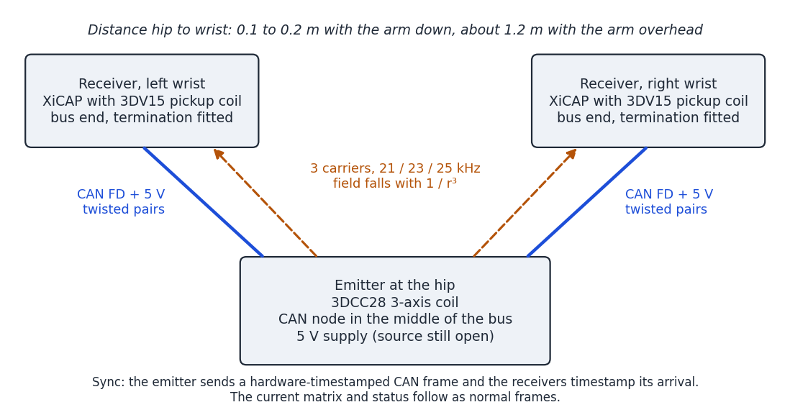
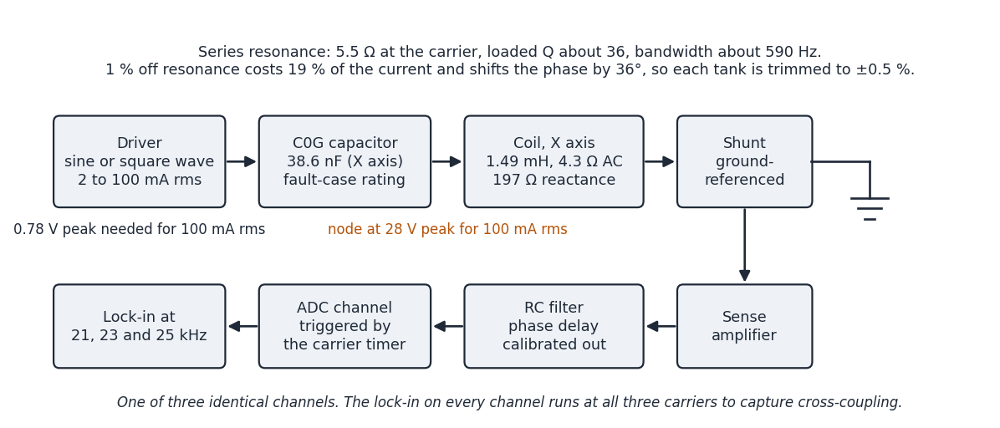
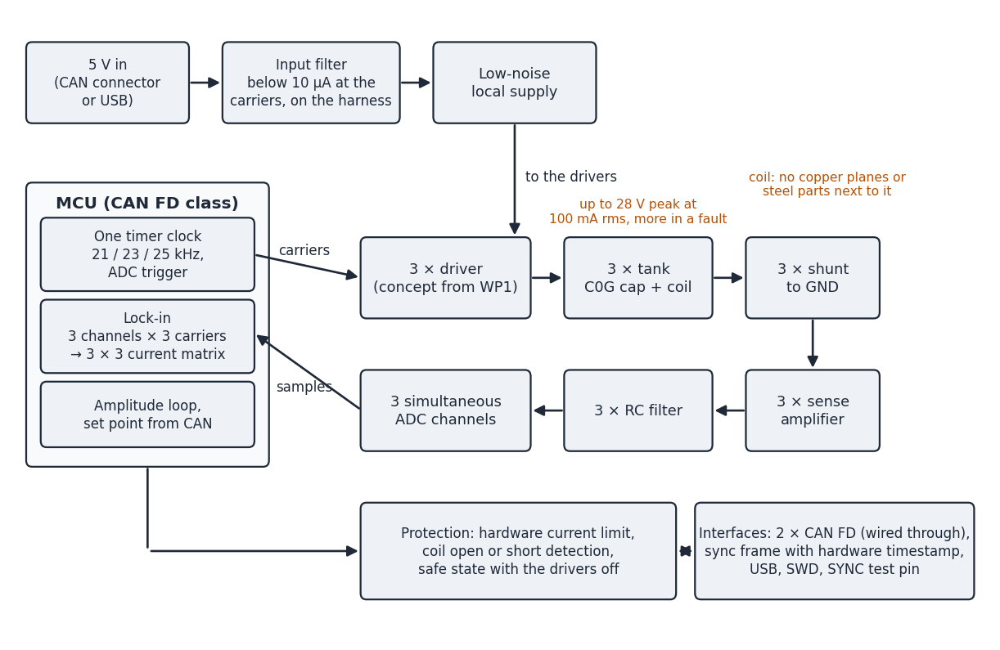

# Engineering plan, rev A

Rev 0.2 · 2026-11-08 · status: planning, nothing measured yet

This document is the working plan for the first emitter board. It records the facts the design
rests on, the calculations behind the design targets, the work packages and the open decisions.
Where a figure is an estimate or comes from memory, it says so.

## 1. Scope

The emitter is a board that drives a 3-axis transmit coil with three continuous sine currents,
one frequency per axis, so that each XiCAP receiver can measure a 3 × 3 coupling matrix and
compute its position and orientation relative to the emitter.

In scope: emitter electronics, schematic, layout, bring-up firmware and characterisation of a
rev A board. Out of scope: the pose algorithm and the receiver, which belong to the tracker.

Already decided:

- The emitter is worn on the body, at the hip.
- The receivers are worn at the wrist.
- Emitter and receivers are wired together with a CAN bus. Sync and data go over CAN.
- The pose solver does not run on the emitter.
- The first build is 3 boards with 3 coils.

Result expected from rev A:

- 3 assembled and tested emitter boards,
- a characterisation report (current stability, phase, distortion, cross-axis coupling),
- one end-to-end test against a XiCAP receiver that confirms the link budget in section 4.3.

## 2. The receiver the emitter feeds

These facts about the XiCAP receive chain constrain the emitter. They are fixed for this project.

| Item | Value |
|---|---|
| Pickup coil | Premo 3DV15-A-S0900J, 9.0 / 9.0 / 10.6 mH, Q about 6 at 20 kHz, SRF at least 200 kHz |
| Coil sensitivity | at least 19 mV per A/m at 20 kHz (datasheet minimum) |
| Tuning | none. The coil is wired straight into the amplifier, so the receiver is broadband |
| Amplifier | instrumentation amplifier, fixed gain 98 |
| Anti-alias filter | single RC, 470 Ω / 3.3 nF, corner 103 kHz |
| ADC | 16-bit, 4 channels sampled simultaneously, single-ended, 2.5 V span centred on 1.25 V |
| Sample rate | 100 to 187.5 kSPS per channel, not frozen yet |
| Full scale at the coil | ±12.5 mV peak for the sum of all three carriers |
| Noise at the coil | about 33 nV rms in a 100 Hz bandwidth (coil resistance, amplifier and ADC together) |
| Clock | the receiver's own crystal. It is not locked to the emitter |
| Wired interface | CAN FD on a JST-SH 4-pin: 1 CAN_H, 2 CAN_L, 3 5 V, 4 GND |

Three consequences:

1. The receiver has no narrow filter in front of the ADC. Everything the emitter radiates below
   about 100 kHz reaches the ADC, and everything above the receiver's Nyquist frequency aliases.
   Harmonics count.
2. The receiver clock is free-running. The emitter has to provide a time reference over CAN,
   otherwise the receiver cannot tell the sign of the field.
3. The receiver gain is fixed. The usable signal range is set by the emitter current alone.

## 3. Review of the original block diagram

The project started from an earlier concept sketch: three DRV8837C H-bridges driving
series-resonant tanks with square waves at 21 / 23 / 25 kHz, a 0.1 Ω shunt per axis read through
an INA241A, an AD4134 24-bit ADC, a PT1000 thermal monitor and an STM32H7. Checking it against
the real coil datasheet, the receiver and the hip-to-wrist geometry changed several numbers and
removed a few blocks.

What stays: frequency multiplexing with one carrier per axis, series-resonant tanks, per-axis
current measurement that produces complex current phasors for the receivers, and a sync signal.

What changes:

| Block | The sketch said | Finding | Plan |
|---|---|---|---|
| Tx coil | 3DCC28-A-0150J, L = 20 mH | Datasheet: 1.49 / 1.46 / 1.39 mH (X/Y/Z), Q 46 at 20 kHz, DCR at most 3.2 Ω, SRF at least 200 kHz | Use the datasheet values. Measure the real parts in WP2 |
| Tx coil | 60 mV / A/m | That is a receive sensitivity. The useful figure is the field: 8.9 nT at 1 m at 0.25 A rms | Link budget in section 4.3 |
| Resonant caps | 12 / 14 / 18 nF | Those values resonate with about 3.3 mH. For 1.5 mH the values are about 39 / 33 / 29 nF | Recalculate from measured L |
| Resonant caps | "film PP + trim" and "C0G" | The capacitor sees 28 V peak at 100 mA rms, and far more in a fault | C0G, voltage rating sized for the fault case, parallel trim footprints |
| Drive level | 1 A class | With the wrist as close as 0.1 to 0.2 m from the hip, the receiver overloads above 6 to 45 mA rms. See 4.3 | 2 to 100 mA rms per axis, changeable at run time |
| Driver | 3 × DRV8837C H-bridge, square wave | At these currents a bridge would need a supply of 25 mV to 1.2 V. See 4.2 | Driver concept is the main WP1 decision. A linear sine driver is a serious candidate |
| Current sense | 0.1 Ω shunt + INA241A | 0.1 Ω gives 10 mV at 100 mA and 0.2 mV at 2 mA | Larger, ground-referenced shunt with a plain amplifier |
| ADC | AD4134, 24-bit, 1.5 MSPS | Far more than needed for three 21 to 25 kHz tones; 300 to 500 mW, a separate 1.8 V I/O rail, an external 48 MHz clock | MCU-internal simultaneous ADCs. Fallback: a small simultaneous-sampling SAR such as the AD7386-4 |
| Thermal monitor | PT1000 + INA240 + ADC | At 100 mA rms the coil dissipates about 55 mW per axis | Dropped. One NTC on the board is enough |
| MCU | STM32H7, 480 MHz | No pose solver on the emitter. Three carriers, three lock-ins and CAN need far less | A smaller MCU with CAN FD, chosen in WP1 |
| Carriers | 21 / 23 / 25 kHz, phase-synchronised | Good: the ratio 21 : 23 : 25 gives a short common frame. All three must come from one timer clock | Keep, subject to the checks in 4.6 |
| Sync | "SYNC signal to receiver nodes" | Now defined: CAN. The receiver needs the time reference better than 10 µs | Hardware-timestamped CAN sync frame. See 4.7 |
| Not in the sketch | | Cross-coupling between the tanks, magnetic-field exposure on the body, stray field from the CAN harness | Sections 4.4, 4.5, 4.7 |

## 4. The numbers behind the changes

All figures use datasheet values and a loop resistance of about 5.5 Ω (coil AC resistance
4.3 Ω, driver about 1 Ω, shunt 0.2 Ω). Nothing has been measured yet. Checking these numbers is
the first task.

### 4.1 Tank values

| Axis | Carrier | L | C for resonance | Coil reactance | Coil AC resistance at Q = 46 |
|---|---|---|---|---|---|
| X | 21 kHz | 1.49 mH | 38.6 nF | 197 Ω | 4.3 Ω |
| Y | 23 kHz | 1.46 mH | 32.8 nF | 211 Ω | 4.6 Ω |
| Z | 25 kHz | 1.39 mH | 29.2 nF | 218 Ω | 4.8 Ω |

With 5.5 Ω in the loop the loaded Q is about 36. That gives a tank bandwidth near 590 Hz and a
settling time constant of about 0.55 ms.

### 4.2 Drive, tuning and drift

- Drive voltage: the tank is only about 5.5 Ω at resonance. 100 mA rms needs a fundamental of
  0.78 V peak, 2 mA rms needs 16 mV peak.
- A square-wave bridge is a poor fit for that range. A half bridge would need a supply between
  24 mV and 1.2 V. At the low end, dead time and the spread of the switch resistance dominate.
- A linear driver fits well: a sine from a DAC, a line-driver op-amp, the tank, a shunt to
  ground. The power is below 0.1 W per axis, so efficiency no longer argues for switching. A sine
  drive also removes the carrier harmonics, which removes the aliasing concern in 4.6.
- With a square-wave bridge and a loaded Q of 36, the third-harmonic current is 0.35 % of the
  fundamental and the fifth 0.12 %.
- Tuning sensitivity: a resonance that is 1 % off the carrier costs 19 % of the current and
  shifts the phase by 36°. At 5 % off, the current drops to 27 %. Coil and capacitor tolerances
  are both several percent, so each tank needs trimming to roughly ±0.5 %.
- Temperature: copper resistance rises 0.39 % per kelvin. With a fixed drive voltage the field
  falls by the same amount.

Conclusion: the emitter needs a closed loop that regulates the measured current amplitude, and it
reports the measured amplitude and phase. The receiver then does not depend on the tank being
perfectly tuned.

### 4.3 Link budget for hip to wrist

The datasheet gives 8.9 nT at 1 m for 0.25 A rms and does not state the direction. From the
coil's sensitivity figure this looks like the broadside value, and the on-axis field is up to
twice as high. Distances below therefore carry about ±25 % uncertainty. Field falls with the cube
of distance.

Geometry assumption: the wrist is 0.1 to 0.2 m from the emitter when the arm hangs down, and
about 1.2 m away when the arm is stretched overhead. That is a field ratio of up to 1700 : 1, or
65 dB, on a receiver with fixed gain.

The current is limited by the closest wrist position, because the receiver ADC must not clip.
The noise at full reach follows from that:

| Closest wrist distance | Highest current without clipping | Signal-to-noise at 1.2 m, 100 Hz | Range noise at 1.2 m |
|---|---|---|---|
| 0.10 m | 5.6 mA rms | 34 dB | about 8 mm |
| 0.15 m | 19 mA rms | 45 dB | about 2 mm |
| 0.20 m | 45 mA rms | 53 dB | about 1 mm |
| 0.25 m | 87 mA rms | 58 dB | about 0.5 mm |

Three conclusions for the emitter:

1. The current range is 2 to 100 mA rms, not 1 A.
2. Where the emitter sits on the hip matters a lot. Moving the closest wrist position from
   0.10 m to 0.20 m buys 19 dB at full reach. A position at the back of the belt is better than
   one at the side, where the wrist passes.
3. The current must be changeable at run time over CAN, so the system can lower it while a wrist
   is close and raise it when both are far. A step should settle within about 10 ms, and the
   reported current must stay valid during the step.

Any remaining gap is closed on the receiver side (switchable gain, longer averaging at long
reach), which is the tracker's concern, not the emitter's.

### 4.4 Cross-coupling between the tanks

The three windings sit on one core. They are nominally orthogonal, but the datasheet gives no
figure for the residual coupling. The Y tank, tuned to 23 kHz, presents only about 39 Ω at
21 kHz. A coupling factor of 1 % would therefore put about 5 % of the X current into the Y
winding at the X frequency. The "21 kHz dipole" would then point about 3° away from the X axis.

This cannot be designed out cheaply, so the emitter must measure it: every current channel is
demodulated at all three carrier frequencies, which gives a 3 × 3 complex current matrix instead
of three phasors. The receiver side uses the full matrix. Measuring the actual coupling factor is
an early WP2 task.

### 4.5 Magnetic-field exposure on the body

The emitter sits against the hip, so the coil is a few centimetres from tissue. The
general-public reference level in the ICNIRP 2010 guideline is 27 µT rms between 3 kHz and
10 MHz (quoted from memory, to be verified). The guideline adds the three carriers, so each axis
may contribute about 9 µT.

With a dipole approximation, the distance from the coil centre at which one axis reaches 9 µT is:

| Current per axis | Distance from coil centre |
|---|---|
| 5.6 mA rms | 3 to 3.5 cm |
| 19 mA rms | 4 to 5 cm |
| 45 mA rms | 6 to 7 cm |
| 87 mA rms | 7 to 9 cm |

The coil itself reaches 2 cm from its centre. So at 45 mA and above, this simple estimate puts
the reference level inside the body.

The estimate is conservative in two ways: it adds three orthogonal fields as if they were
aligned, and reference levels assume whole-body exposure, while this field is very local. It is
also crude: the dipole formula is poor this close to a 40 mm coil. A proper assessment is a WP1
task. Possible outcomes are a current limit near 20 mA, a spacer between coil and body, or a
calculation against the guideline's basic restrictions that allows more.

Exposure and the near-wrist limit in 4.3 point the same way: low current.

### 4.6 Frequency plan checks

- What must be exact is the ratio 21 : 23 : 25 and a common frame. Timer periods of 575 n,
  525 n and 483 n ticks give that ratio at any timer clock, with a frame of 12075 n ticks.
- An exact 1.000 ms frame additionally needs a timer clock that is a multiple of 12.075 MHz.
  Exactly 1 ms is preferred because the receiver processes whole frames. If the MCU clock tree
  cannot do it, the real frame length must be documented, or another triplet proposed. For
  example, a 168 MHz timer clock divides exactly into 20, 21, 24 and 25 kHz, but not into 23 kHz.
- The ADC trigger for the current measurement comes from the same timer, with a whole number of
  samples per frame.
- With a square-wave drive, any triplet must be checked against the receiver: no harmonic of one
  carrier may land on another carrier, directly or after aliasing at the receiver's sample rate.
  At 100 kSPS the current triplet is clean.

### 4.7 CAN: sync, topology and the harness

Sync:

- The receiver must know the emitter's carrier phase to better than a quarter period of the
  highest carrier, which is 10 µs. The target is 1 µs. After that the receiver tracks the
  carriers themselves.
- Proposal: the emitter sends a sync frame at a fixed rate. It captures the moment that frame
  goes onto the bus in hardware, in the time base of the carrier timer, and sends that timestamp
  in the next frame. The receiver timestamps the same frame on arrival. Software timestamps are
  not good enough.
- The current matrix and status go out as ordinary frames, at 100 Hz or faster. The protocol is
  defined on the tracker side.

Topology:

- With the emitter at the hip and one receiver at each wrist, the emitter is the middle of the
  bus and the receivers are its ends. The board provides two CAN connectors wired through, and a
  termination that can be fitted or left out.

Harness:

- The cable to the wrist runs past the receiver coil. A current of 1 mA at a carrier frequency in
  a single untwisted wire produces, 2 cm away, as much field as the emitter itself produces at
  1 m with 0.25 A rms.
- So tank current must not return through the harness, and the emitter's supply current must be
  clean at the carrier frequencies. Proposed limit: below 10 µA rms at each carrier frequency on
  the harness supply wires, to be confirmed in WP1. That means filtering between the driver
  supply and the connector.
- The harness uses twisted pairs for power and for CAN.

## 5. Proposed rev A architecture

Design rules:

- One timer clock generates all three carriers, the ADC trigger and the CAN timestamp.
- The three carriers have a fixed, documented phase relation at the start of every frame.
- The sense chain's own phase delay (amplifier plus filter) is calibrated out. Target residual:
  0.1°.
- No copper planes under or next to the coil, and no steel parts near it (connector shells,
  shielded inductors, screws, battery). Eddy currents and steel distort the field and lower Q.
- Voltage rating and creepage at the coil-capacitor node sized for the fault case, where the
  driver puts its full supply across a tuned tank.
- A hardware current limit that does not depend on firmware, because the board is worn on the
  body.
- Any switching regulator stays away from 15 to 30 kHz and from the low harmonics of the
  carriers.

## 6. Target specification, rev A

These are proposals, frozen at the end of WP1.

| Parameter | Target |
|---|---|
| Coil | Premo 3DCC28-A-0150J, through-hole, 39.5 × 39.5 × 38.6 mm |
| Carriers | 21 / 23 / 25 kHz, continuous, from one clock |
| Coil current | 2 to 100 mA rms per axis, set per axis over CAN |
| Current step | settles within 10 ms, reported current valid throughout |
| Amplitude stability | 0.1 % over 10 minutes at constant temperature |
| Amplitude over temperature | reported value correct within 0.5 % from 10 to 50 °C |
| Reported phase | within 0.1° after calibration |
| Current distortion | harmonics below 1 % of the fundamental |
| Current matrix | 3 × 3 complex values, updated at 100 Hz or faster |
| Sync | CAN sync frame timestamped in hardware, error below 1 µs against the carriers |
| Harness cleanliness | below 10 µA rms at each carrier frequency on the supply wires |
| Supply | 5 V. Source still open, see D1 |
| Interfaces | CAN FD on 2 × JST-SH 4-pin (pinout in section 2), USB, SWD, SYNC test pin |
| Protection | hardware current limit, coil open or short detection, safe state with drivers off |
| Board | 2 or 4 layers. Size is free for rev A, but wearable: coil plus board in one small box |

## 7. Work packages

Durations are rough guesses for part-time work.

### WP0, kick-off (1 session)

Go through this document, settle the open decisions in section 8, agree on tools and how files
are exchanged. Done when every open decision has an answer or an owner.

### WP1, paper design and simulation (1 to 2 weeks)

- Driver concept for 2 to 100 mA rms: linear sine driver against a square-wave bridge. This is
  the main decision of the work package.
- Tank design with tolerance and temperature analysis, and a trimming concept.
- Simulation of the three coupled tanks: currents, harmonics, cross-currents as a function of the
  coupling factor, behaviour during a current step.
- Sense chain error budget over the 50 : 1 current range: shunt value and temperature
  coefficient, amplifier, filter, ADC, phase calibration.
- MCU choice, clock tree and timer plan, including the hardware CAN timestamp.
- Supply and input filter concept that meets the harness limit in 4.7.
- Exposure assessment from 4.5, and the current limit that follows from it.
- Fault analysis: highest possible tank voltage and current, and what limits them.

Deliverable: a design note of a few pages plus the simulation files. Done when it has been
reviewed and section 6 is frozen.

### WP2, bench prototype on evaluation boards (1 to 2 weeks)

Build one axis, then three, from an MCU evaluation board, the chosen driver, the real coil and
C0G capacitors. Measure:

- L, Q and AC resistance of each axis from 15 to 30 kHz, cold and warm,
- the coupling factor between the axes,
- current waveform and harmonics, and tuning sensitivity,
- cross-currents with all three axes running,
- carrier-frequency current on the supply wires,
- field at a known distance, using a 3DV15 pickup coil or a XiCAP board, against the datasheet
  figure of 8.9 nT.

Deliverable: a short measurement report. Done when the measurements agree with the WP1 model or
the model is corrected, and the decision to go to layout is taken.

### WP3, schematic and layout, rev A (2 to 3 weeks, plus fabrication)

- Schematic and PCB in KiCad.
- Test points on every tank node that is safe to probe, and a clear warning on the ones that
  are not.
- Parallel footprints for capacitor trimming.
- A schematic review and a layout review before ordering.

Deliverable: KiCad project, BOM, fabrication files, 3 assembled boards. Done when the boards are
ordered after both reviews.

### WP4, bring-up and characterisation (2 to 3 weeks)

- Bring-up firmware: carrier generation, ADC and lock-in, the amplitude loop, protection, the CAN
  sync frame, and streaming of the current matrix.
- Characterisation against every row of section 6.
- Tuning and calibration procedure for one unit, written down so it can be repeated.

Deliverable: characterisation report, firmware source, calibration procedure. Done when every row
of section 6 is measured and either met or explained.

### WP5, integration with the XiCAP receiver (1 to 2 weeks)

- Signal level and noise with the emitter at the hip and the receiver at the wrist, arm down and
  arm stretched, compared with section 4.3.
- Sync and sign resolution end to end over CAN.
- Run-time current changes while the receiver is tracking.
- Check that the emitter and the harness do not disturb the tracker's other sensors and radio.
- List of changes for rev B.

Done when there is a joint test report and a rev B list.

## 8. Decisions

Settled:

| Decision | Answer |
|---|---|
| Where the emitter is used | Worn on the body, at the hip. Receivers at the wrist |
| Sync transport | CAN bus |
| Pose solver on the emitter | No |
| First build | 3 boards, 3 coils |

Still open:

| # | Decision | Owner | Why it matters |
|---|---|---|---|
| D1 | Power: does the emitter carry the battery and feed 5 V to the receivers, or is it fed from elsewhere? | tracker side | Sets the supply design, the input filter and the connector current |
| D2 | Exact position on the hip, and the closest wrist distance to design for | tracker side | Sets the current range. See the table in 4.3 |
| D3 | Number of receivers on the bus | tracker side | Sets connectors and termination. Two assumed |
| D4 | Driver concept and MCU | emitter designer, in WP1 | Everything else follows from it |
| D5 | Who writes which firmware, and which toolchain | both | Proposal: bring-up firmware with the emitter, CAN protocol with the tracker |
| D6 | Who orders parts | tracker side | Coils cost about 31 EUR each and were out of stock in the maker's web shop on 2026-11-08 |

## 9. Risks

| Risk | Effect | What we do about it |
|---|---|---|
| Wrist close to the emitter forces a very low current | Noisy position at full reach | Emitter position, run-time current control, receiver-side measures |
| Exposure limit below the wanted current | Same effect | Assessment in WP1, spacer, current limit |
| Inter-axis coupling larger than assumed | Field axes tilt, and the tilt drifts with tuning | Measure early in WP2, report the full 3 × 3 matrix, consider wider carrier spacing |
| Carrier-frequency current on the harness | Stray field next to the receiver coil, position errors that move with the cable | Input filter, harness limit in the spec, twisted pairs, measurement in WP2 |
| Tank drifts off resonance with temperature | Loss of current, driver runs out of headroom | C0G capacitors, drive headroom of at least 3×, amplitude loop |
| CAN timestamp not good enough | Sign of the field unresolved | Hardware capture on both sides, tested early in WP4 |
| Coil lead time | WP2 slips | Order coils at kick-off. The 3DCC20 is a smaller alternative |
| Fault puts full supply across a tuned tank | High voltage on the capacitor, high field next to the body | Hardware current limit, voltage ratings, fault analysis in WP1 |
| Datasheet field figure is ambiguous | Range estimates off by up to 25 % | Field measurement in WP2 |

## 10. Inputs from the tracker side

- Datasheets for the emitter coil and the pickup coil (see [references.md](references.md)).
- The receiver's analog chain as a schematic excerpt, and the final sample rate.
- Three coils and a XiCAP board for WP2 and WP5.
- The CAN protocol definition before WP4.
